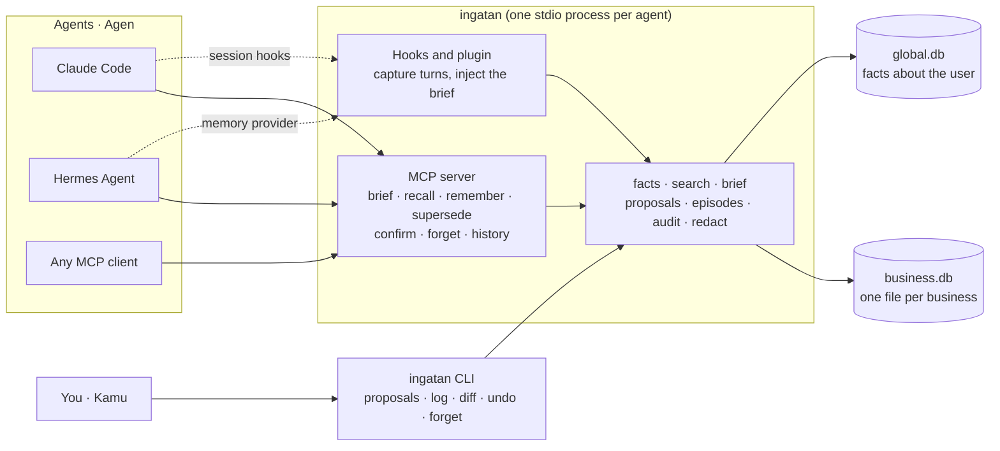

<div align="center">


# Ingatan

**Memory for AI agents that knows when to doubt itself.**<br>
**Memori untuk agen AI yang tahu kapan harus meragukan dirinya sendiri.**

A local MCP server backed by plain SQLite files. Full-text search out of the box with zero API keys and no model; offline semantic search is an optional add-on.<br>
Server MCP lokal di atas berkas SQLite biasa. Pencarian teks penuh langsung jalan tanpa API key dan tanpa model; pencarian semantik offline adalah tambahan opsional.

<p>

<a href="https://github.com/araaking/ingatan0-mem/actions/workflows/ci.yml"></a>


</p>

**[Bahasa Indonesia](#bahasa-indonesia)** &nbsp;·&nbsp; **[English](#english)**

</div>

> [!WARNING]
> **Pre-release.** Ingatan is not on PyPI yet and has not been used in a real agent session. Read [Status](#en-status) before you rely on it.<br>
> **Pra-rilis.** Ingatan belum ada di PyPI dan belum pernah dipakai di sesi agen sungguhan. Baca [Status](#id-status) sebelum mengandalkannya.

## Architecture · Arsitektur



The business and the agent name are fixed when the server starts (or restricted to an explicit `allowed_businesses` list in multi-business mode), so no tool call can reach an unauthorized business. Facts save directly by default (write-then-undo: every change is logged and undoable in the CLI); opt in to `require_approval = true` if you want a manual proposal queue.

Nama bisnis dan nama agen dikunci saat server menyala (atau dibatasi ke daftar `allowed_businesses` pada mode multi-bisnis), jadi tidak ada pemanggilan tool yang bisa menjangkau bisnis di luar izin. Fakta langsung tersimpan secara bawaan (write-then-undo: setiap perubahan tercatat dan bisa di-`undo` di CLI); aktifkan `require_approval = true` bila ingin memakai antrean proposal manual.

---

<a id="bahasa-indonesia"></a>

## Bahasa Indonesia

**Daftar isi:** [Ringkasan](#id-ringkasan) · [Fitur utama](#id-fitur) · [Persyaratan](#id-persyaratan) · [Instalasi](#id-instalasi) · [Mulai cepat](#id-mulai-cepat) · [Mode HTTP](#id-http) · [Konfigurasi](#id-konfigurasi) · [Tujuh tool](#id-tool) · [Tier dan antrean proposal](#id-tier) · [Status fakta](#id-status-fakta) · [Forget dan batasannya](#id-forget) · [CLI](#id-cli) · [Data dan privasi](#id-data) · [Angka terukur](#id-angka) · [Status](#id-status) · [Struktur proyek](#id-struktur) · [Pengembangan](#id-pengembangan) · [Peta jalan](#id-peta-jalan) · [Masalah umum](#id-masalah) · [Lisensi dan kredit](#id-lisensi)

**Mulai dalam tiga perintah:**

```bash
uv tool install ingatan
cd proyek-kamu
ingatan setup
```

Perintah pertama **belum berfungsi**: Ingatan belum ada di PyPI, jadi sampai rilis pasanglah dari hasil clone (lihat [Instalasi](#id-instalasi)). `ingatan setup` menanyakan nama bisnis dan agen, mau memakai pencarian semantik atau tidak, dan klien mana yang disambungkan, lalu menjalankan pemeriksaan `doctor`.

<a id="id-ringkasan"></a>

### Ringkasan

Ingatan adalah memori bersama untuk agen AI. Ia berjalan sebagai server MCP lewat stdio dan menyimpan semuanya di berkas SQLite di mesinmu sendiri: satu berkas per bisnis, ditambah satu berkas untuk fakta tentang kamu.

Ingatan dibuat untuk orang yang memakai beberapa agen (asisten umum, agen SEO, agen penulis, agen coding) di beberapa bisnis, dan lelah menjelaskan konteks yang sama berulang kali.

<a id="id-fitur"></a>

### Fitur utama

| | Yang dilakukan Ingatan |
|---|---|
| **Fakta punya tanggal tinjau** | Fakta `volatile` punya tanggal tinjau (bawaan 30 hari, bisa diatur per fakta). Setelah lewat, fakta itu tampil di bagian "check first", bukan sebagai kebenaran. |
| **Pencarian FTS5, semantik lokal opsional (tanpa API key)** | Pencarian berjalan di SQLite FTS5 (BM25 + trigram + imbuhan Indonesia + kamus alias) yang digabung lewat RRF, tanpa model sama sekali. Model embedding offline (`multilingual-e5-small` int8 lewat ONNX Runtime) bersifat opsional: `ingatan embeddings pull`, lalu `provider = "local"`. Ollama, endpoint kompatibel OpenAI, dan Gemini juga didukung. Apa yang ditambahkannya dan berapa biayanya diukur di [docs/EMBEDDINGS.md](docs/EMBEDDINGS.md). |
| **Paham imbuhan Indonesia & alias** | Pelepas imbuhan ringan memperluas query ("dikirim" -> "pengiriman"), ditambah kamus alias per proyek (`ingatan alias add LP "landing page"`) untuk ekspansi dua arah. |
| **Kategori memori, pin, relasi, & time-travel** | Fakta mendukung kategori (`fact`, `rule`, `procedure`, `preference`), `pinned`, deteksi pengulangan persis, relasi antar-fakta (`related_to`, `part_of`), serta pencarian historis `recall(..., as_of="YYYY-MM-DD")`. |
| **Scope dikunci server** | Bisnis dan agen ditentukan dari berkas konfigurasi atau variabel lingkungan saat server menyala. Tidak ada tool yang menerima nama bisnis, dan tidak ada pencarian lintas bisnis. |
| **Langsung simpan, bisa di-undo** | Bawaan memakai pola *write-then-undo* (fakta `business`/`global` langsung tersimpan dan selalu bisa dibatalkan lewat `ingatan undo`). Bila ingin antrean persetujuan manual, set `require_approval = true` di config. |
| **Bisa diaudit dan dibatalkan** | Setiap perubahan masuk log append-only. Kamu bisa membaca, membandingkan, dan membatalkannya. |
| **Lupa berarti benar-benar hilang** | `forget` menghapus isi fakta sampai ke byte di berkas database dan berkas WAL. |
| **Rahasia disamarkan** | Teks yang mirip API key, kata sandi, atau token diganti `[redacted]` sebelum disimpan. |

Perbandingan dengan mem0, Hindsight, Graphiti, dan claude-mem ada di [docs/DESIGN.md](docs/DESIGN.md). Perbandingan itu dibuat dengan membaca kode sumber mereka; tidak ada yang dijalankan.

<a id="id-persyaratan"></a>

### Persyaratan

- Python 3.10 atau lebih baru.
- SQLite 3.42 atau lebih baru dengan FTS5, tokenizer trigram, dan FTS5 secure-delete. `ingatan doctor` memeriksa semuanya.
- [uv](https://docs.astral.sh/uv/) untuk instalasi dan pengembangan.
- Tidak perlu Docker, Postgres, atau layanan lain.

<a id="id-instalasi"></a>

### Instalasi

Ingatan belum dirilis ke PyPI, jadi pasang secara editable dari hasil clone (agar `git pull` langsung memakai kode terbaru setelah restart MCP):

```bash
uv tool install --editable /path/to/ingatan
```

Setelah rilis PyPI nanti, cukup satu perintah (saat ini **belum berfungsi**):

```bash
uv tool install ingatan
```

> Pencarian semantik bersifat opsional dan mati secara bawaan. Untuk menyalakannya, pasang dengan extra `vector` (`uv tool install "ingatan[vector]"` setelah rilis; dari hasil clone tambahkan `--with numpy --with onnxruntime --with sentencepiece`), lalu jalankan `ingatan embeddings enable`. Satu perintah itu mengunduh model (123 MB, sekali saja), menulis `provider = "local"`, dan meng-embed fakta yang sudah ada. Server sendiri tidak pernah mengunduh apa pun. Rinciannya di [docs/EMBEDDINGS.md](docs/EMBEDDINGS.md).

<a id="id-mulai-cepat"></a>

### Mulai cepat

```bash
cd proyek-kamu
ingatan setup   # nama bisnis dan agen, pencarian semantik (opsional), klien, lalu pemeriksaan doctor
```

`setup` aman dijalankan dua kali, dan setiap pertanyaannya punya opsi sehingga bisa dijalankan tanpa terminal: `ingatan setup --business tokoku --agent claude-code --no-semantic --client claude-code --yes`. Untuk Claude Code ia menambahkan server ke `.mcp.json` proyek: perubahannya ditampilkan dulu dan baru ditulis setelah kamu setuju. Untuk Hermes ia mencetak blok `mcp_servers` untuk ditempel dan tidak menulis berkas apa pun. Kalau hanya butuh berkas konfigurasi dan database, `ingatan init --business tokoku --agent claude-code` lalu `ingatan doctor` tetap ada.

Panduan per agen, termasuk bagian yang tidak diurus `setup` (hook dan plugin):

| Agen | Panduan | Isi |
|---|---|---|
| Claude Code | [docs/setup-claude-code.md](docs/setup-claude-code.md) | Server MCP, plus hook opsional untuk menyuntikkan brief dan menangkap percakapan |
| Hermes Agent | [docs/setup-hermes.md](docs/setup-hermes.md) | Server MCP, plus plugin memory provider |

Untuk Claude Code, bentuk singkatnya:

```bash
claude mcp add --scope project ingatan -- ingatan serve
```

Kedua panduan menandai mana yang sudah dan belum diverifikasi.

Begitu tersambung, agen memakai tool seperti ini:

```python
remember(
    text="Harga kopi susu naik jadi Rp 18.000 mulai Senin.",
    keywords=["harga", "naik", "kopi", "menu"],  # sinonim dan kata dasar
    entities=["kopi susu"],
)
recall(query="harga kopi susu")
```

<a id="id-http"></a>

### Mode HTTP (opsional)

Satu server Ingatan di mesin yang kamu kuasai (VPS atau server rumah) bisa melayani memori yang sama ke semua perangkat. Klien cukup memakai URL dan token; paket `ingatan` tidak perlu terpasang di sana.

```bash
ingatan token add --business kopi --agent claude-mac    # token tampil sekali
ingatan serve --http                                    # 127.0.0.1:8765, jalur /mcp
```

Setiap token terikat ke satu bisnis dan satu agen. Tidak ada enkripsi di dalam Ingatan: pasang reverse proxy atau jaringan privat (Tailscale, WireGuard) di depannya. Hook dan plugin Hermes belum bisa lewat HTTP. Panduan lengkap: [docs/setup-http.md](docs/setup-http.md).

<a id="id-konfigurasi"></a>

### Konfigurasi

`.ingatan.toml` dicari di folder saat ini atau folder induk terdekat:

```toml
business = "tokoku"
agent = "claude-code"

[brief]
token_budget = 1000

# Pencarian semantik opsional (bawaan: mati). Lihat docs/EMBEDDINGS.md.
# [embeddings]
# provider = "local"         # none (bawaan) | local | ollama | openai | gemini
# model = "xenova/multilingual-e5-small"   # model lokal bawaan (int8, unduhan 123 MB)
# threads = 2                # thread ONNX (hanya memengaruhi kecepatan, bukan RAM)
# idle_unload_seconds = 300  # lepas model lokal dari RAM setelah diam 5 menit (0 = tetap muat)
# defer = true               # remember langsung menyimpan; server mengisi vektor & cek konflik makna belakangan
# shared = true              # satu proses memegang model untuk semua sesi (hanya 127.0.0.1), bukan satu salinan per sesi
# recall_floor = 0.83        # ambang kemiripan; bawaannya dikalibrasi per keluarga model

# Ekstraksi fakta opsional (bawaan: mati). Hanya dipakai oleh `ingatan extract`.
# [llm]
# provider = "ollama"       # none (bawaan) | ollama | openai (endpoint apa pun yang kompatibel dengan OpenAI)
# model = "..."             # wajib diisi: Ingatan tidak memilihkan model
# api_base = "http://localhost:11434"
```

| Variabel lingkungan | Fungsi |
|---|---|
| `INGATAN_BUSINESS` | Menimpa `business` dari berkas konfigurasi |
| `INGATAN_AGENT` | Menimpa `agent` dari berkas konfigurasi |
| `INGATAN_HOME` | Folder data. Bawaan: `~/.ingatan/` |
| `INGATAN_EMBED_PROVIDER` | Menimpa `[embeddings].provider` (`none`, `local`, `ollama`, `openai`, `gemini`; bawaan `none`) |
| `INGATAN_EMBED_MODEL` | Menimpa `[embeddings].model` |
| `INGATAN_EMBED_THREADS` | Menimpa jumlah thread ONNX `[embeddings].threads` (bawaan: `2`) |
| `INGATAN_EMBED_IDLE_UNLOAD` | Menimpa detik *idle auto-unload* model lokal (bawaan: `300`, `0` = nonaktif) |
| `INGATAN_MODEL_DIR` | Folder berkas model lokal. Bawaan: `<INGATAN_HOME>/models` |
| `INGATAN_EMBED_DEFER`, `INGATAN_EMBED_SHARED` | Menimpa `[embeddings].defer` dan `[embeddings].shared` (`1`/`0`) |
| `INGATAN_LLM_PROVIDER`, `INGATAN_LLM_MODEL`, `INGATAN_LLM_API_BASE`, `INGATAN_LLM_API_KEY_ENV` | Menimpa `[llm]` untuk `ingatan extract` (bawaan `none`: tidak ada yang dikirim ke model) |

<a id="id-tool"></a>

### Tujuh tool

| Tool | Fungsi |
|---|---|
| `brief()` | Ringkasan awal sesi dalam anggaran token (bawaan 1.000): fakta "check first", lalu fakta global, bisnis, dan agen, jumlah proposal yang menunggu, dan paling banyak tiga episode untuk dicerna. |
| `recall(query)` | Fakta valid yang cocok (leksikal + alias + semantik opsional), mendukung `as_of` (time-travel), filter `category`, `include_related` (fakta tertaut, sampai dua tautan jauhnya), `include_closed`, dan `compact`. |
| `remember(text, ...)` | Menyimpan fakta (`keywords` opsional, `category`, `pinned`, `related_to`). Teks yang sama persis hanya menyegarkan fakta yang sudah ada (`dedup=true`); teks yang sekadar mirip selalu disimpan. Mengembalikan fakta serupa yang berpotensi konflik. |
| `supersede(old, new)` | Menutup fakta lama dan menautkannya ke yang baru (langsung berlaku secara bawaan, atau jadi proposal jika `require_approval = true`). |
| `confirm(id, reason)` | Menyatakan fakta yang diragukan masih benar dan memajukan tanggal tinjaunya. Alasan wajib dan dicatat. |
| `forget(id)` | Menghapus isi fakta untuk selamanya. Agen hanya boleh menghapus tier `agent`; `business`/`global` lewat CLI. |
| `history(id atau entitas)` | Riwayat perubahan sebuah fakta, proposal, atau entitas. |

<a id="id-tier"></a>

### Tier, write-then-undo, dan antrean proposal (opsional)

| Tier | Arti | Cara tertulis (bawaan) | Jika `require_approval = true` |
|---|---|---|---|
| `agent` | Pribadi untuk satu agen di satu bisnis | Langsung tersimpan | Langsung tersimpan |
| `business` | Dibagi ke semua agen di satu bisnis | Langsung tersimpan (bisa di-`undo`) | Menjadi proposal |
| `global` | Tentang kamu, terlihat di semua bisnis | Langsung tersimpan (bisa di-`undo`) | Menjadi proposal |

Secara bawaan, Ingatan memakai pola **write-then-undo**: fakta langsung tersimpan agar alur kerja tidak tersendat, dan setiap perubahan tercatat di log append-only sehingga bisa dilihat (`ingatan diff`) atau dibatalkan (`ingatan undo`). Jika kamu ingin persetujuan manual di CLI, aktifkan `require_approval = true` di `.ingatan.toml` / `~/.ingatan/config.toml` atau `INGATAN_REQUIRE_APPROVAL=1`:

```bash
ingatan proposals list --business tokoku
ingatan proposals approve p_0123456789ab --business tokoku
ingatan proposals approve --all --business tokoku
ingatan proposals reject p_0123456789ab --business tokoku
```

<a id="id-status-fakta"></a>

### Status fakta

- **check first**: fakta `volatile` yang sudah lewat tanggal tinjaunya, atau ada proposal yang menunggu untuk menggantikannya. Brief menaruhnya di bagian tersendiri dan meminta agen tidak bertindak sebelum memeriksa. `confirm` atau `supersede` menghapus tanda ini.
- **possible conflict**: saat `remember` menemukan fakta serupa, pasangan itu dicatat sebagai konflik terbuka. Kedua fakta membawa tanda ini sampai agen menyelesaikannya dengan `supersede`, atau dengan `confirm` yang menyebut id fakta satunya di alasan. Pencocokannya leksikal, jadi bisa melewatkan konflik nyata dan bisa menandai dua fakta yang sebenarnya sejalan.

`ingatan conflicts` melaporkan dari log audit berapa kandidat konflik yang diselesaikan.

<a id="id-forget"></a>

### Forget dan batasannya

`forget` menghapus baris fakta, entri indeks pencarian, pasangan konfliknya, salinan di proposal, episode asalnya, dan isi semua entri log sebelumnya tentang fakta itu. Satu entri log tanpa isi tetap ada, supaya jejak audit menunjukkan bahwa sebuah forget pernah terjadi.

<details>
<summary><strong>Batasan yang perlu kamu tahu</strong></summary>

- **Cadangan dan salinan lama tidak tersentuh.** Backup, folder sinkronisasi, atau snapshot disk yang dibuat sebelum forget masih memuat fakta itu.
- **Catatan WAL.** Pembersihan butuh database bebas sesaat. Kalau proses Ingatan lain sedang menyibukkannya, `forget` tetap menghapus fakta tetapi melaporkan bahwa byte lama mungkin masih ada di WAL sampai proses itu selesai.
- Tidak ada janji tentang cara perangkat penyimpanan atau sistem berkas menangani blok yang dibebaskan.
- Forget tidak bisa dibatalkan. Fakta yang ditutup demi fakta yang dilupakan tetap tertutup.
- Agen hanya bisa melupakan fakta tier agen miliknya sendiri. Fakta bisnis atau global butuh kamu: `ingatan forget <fact_id>`.

</details>

<a id="id-cli"></a>

### CLI

Perintah bertindak sebagai kamu untuk bisnis dan agen yang dikonfigurasi. Gunakan `--business NAMA` (`-b`) di perintah mana pun tanpa perlu `cd` ke folder proyek, atau simpan default bersama (`default_agent`, `require_approval`, `[brief].token_budget`) di `~/.ingatan/config.toml`. Entri pribadi agen lain tetap tersembunyi; gunakan `--agent NAMA` untuk membukanya.

| Perintah | Fungsi |
|---|---|
| `ingatan` / `ingatan serve` | Menjalankan server MCP lewat stdio (mendukung mode multi-bisnis via `INGATAN_BUSINESSES`) |
| `ingatan serve --http [--host H] [--port P]` | Menjalankan server MCP lewat HTTP (bearer token) |
| `ingatan setup [--business B] [--agent A] [--semantic\|--no-semantic] [--client claude-code\|hermes\|none] [--yes]` | Penyiapan terpandu: proyek, pencarian semantik opsional, klien, lalu pemeriksaan `doctor` |
| `ingatan token add --business B --agent A [--label L]`, `list`, `revoke <id>` | Mengelola token mode HTTP |
| `ingatan init [--business NAMA] [--agent NAMA]` | Membuat `.ingatan.toml` dan database |
| `ingatan doctor [--business NAMA]` | Memeriksa Python, fitur SQLite, konfigurasi, embedding, database, dan folder data |
| `ingatan log [--limit N] [--fact ID] [--business NAMA] [--agent NAMA]` | Daftar entri log, terbaru dulu |
| `ingatan diff <log_id> [--business NAMA]` | Sebelum dan sesudah satu entri log |
| `ingatan undo <log_id> [--business NAMA]` | Membatalkan create, supersede, confirm, atau approve (bukan forget) |
| `ingatan proposals list`, `approve <id...> \| --all`, `reject <id>` | Meninjau dan menyetujui proposal (satuan atau massal) |
| `ingatan forget <fact_id> [--yes] [--business NAMA]` | Melupakan fakta dari tier mana pun |
| `ingatan ingest <path> [--business NAMA]` | Membaca berkas Markdown menjadi catatan yang bisa dicari (melewati `.git`/`.venv`/`node_modules`) |
| `ingatan extract [--limit N] [--dry-run] [--documents] [--retry-failed] [--business NAMA] [--agent NAMA]` | Opsional: model yang kamu atur di `[llm]` membaca episode yang tertunda (atau, dengan `--documents`, catatan hasil ingest yang belum dibaca) dan mengusulkan fakta. Semuanya masuk antrean proposal dengan tanda `extracted by`; tidak ada yang menjadi fakta sebelum kamu setujui. Teks yang tiga kali gagal dibaca model dilewati sampai kamu memakai `--retry-failed`, dan usulan yang sudah kamu tolak tidak diusulkan lagi |
| `ingatan import <file.jsonl\|json> [--business NAMA] [--scan-conflicts]` | Impor massal fakta dengan tanggal asli |
| `ingatan move <fact_id> --to <business> [--business NAMA]` | Memindahkan fakta antar database bisnis |
| `ingatan conflicts`, `conflicts list`, `conflicts scan [--dry-run]` | Laporan audit konflik, daftar konflik terbuka, dan pindai ulang fakta |
| `ingatan conflicts review [--apply keep_both\|keep_newer\|keep_older --all]` | Menyelesaikan pasangan konflik terbuka satu per satu tanpa mengetik id: simpan keduanya (ditautkan), yang baru atau yang lama menggantikan yang lain, lupakan salah satu, atau lewati. Semuanya tercatat dan bisa di-undo, kecuali lupa |
| `ingatan reindex [--force] [--business NAMA]` | Menghitung/memperbarui vektor embedding untuk fakta & catatan yang sudah ada |
| `ingatan embeddings enable [--model NAMA] [--global] [--no-reindex]` | Menyalakan pencarian semantik dalam satu langkah: unduh model bila belum ada, tulis `provider = "local"`, embed fakta yang sudah ada |
| `ingatan embeddings serve [--idle-seconds N]`, `embeddings stop` | Menjalankan atau menghentikan proses model bersama (`[embeddings] shared`); server menyalakannya sendiri saat dibutuhkan |
| `ingatan embeddings pull [--model NAMA]` | Hanya mengunduh dan memverifikasi model embedding lokal. Pengunduhan hanya terjadi lewat perintah ini, `embeddings enable`, dan `setup` |
| `ingatan alias add <term> <canonical>`, `list`, `remove <term>` | Mengelola kamus alias per proyek untuk ekspansi query dua arah |
| `ingatan link <src> <dst> [--relation related_to\|part_of]`, `unlink` | Menautkan fakta yang saling melengkapi (juga menyelesaikan konflik terbuka di antara keduanya) |
| `ingatan pin <fact_id>`, `unpin <fact_id>` | Menyematkan fakta agar diprioritaskan di `brief` dan `recall` |
| `ingatan hook <event>` | Titik masuk hook Claude Code; selalu keluar dengan kode 0 |

<a id="id-data"></a>

### Data dan privasi

- Folder data adalah `$INGATAN_HOME` bila diatur, selain itu `~/.ingatan/`. Tidak ada yang disimpan di folder proyek, jadi memori tidak bisa ikut ter-commit ke git.
- `<business>.db` menyimpan fakta bisnis dan agen, episode, catatan, dan konflik. `global.db` menyimpan fakta global. Keduanya berkas SQLite biasa.
- `capture-errors.log` di folder data mendapat satu baris saat hook atau plugin gagal. Hook tidak pernah menghentikan sesi agen.
- Penyamaran rahasia memakai pencocokan pola dan bisa meleset.
- Server tidak melakukan panggilan jaringan, kecuali kamu memilih penyedia embedding jarak jauh (`ollama`, `openai`, `gemini`): saat itu teks fakta dan query dikirim ke endpoint tersebut. Model lokal hanya diunduh ketika kamu menjalankan `ingatan embeddings pull`, atau `ingatan embeddings enable` dan `ingatan setup` yang memanggilnya untukmu.
- `ingatan extract` bersifat opsional dan mati secara bawaan. Kalau kamu mengisi `[llm]`, teks episode (percakapan yang ditangkap, setelah disamarkan) dan paling banyak lima fakta terkait yang sudah tersimpan dikirim ke model yang kamu tunjuk: Ollama di mesinmu, atau endpoint yang kamu tulis di `api_base`. Dengan `--documents` yang dikirim adalah teks tiap bagian catatan hasil ingest beserta nama berkasnya (bukan path lengkapnya). Teks itu tidak dikirim ke penyedia embedding: fakta terkait dicari dengan kata saja. Server dan `remember` tidak pernah memanggil model itu.

<a id="id-angka"></a>

### Angka terukur

Sumber: [evals/reports/latest.md](evals/reports/latest.md) dan [evals/reports/latest-semantic.md](evals/reports/latest-semantic.md) (dijalankan 2026-11-23, tanpa LLM, tanpa jaringan), [docs/RAM.md](docs/RAM.md), dan [docs/EMBEDDINGS.md](docs/EMBEDDINGS.md).

Eval berisi 49 skenario berbahasa Indonesia (46 berbasis pola + 3 skenario insiden teranonimisasi). Satu di antaranya butuh model embedding dan dilewati pada run bawaan. Kolom model lokal berasal dari run sebelum skenario `usage` dan `graph` ditambahkan; jalankan ulang `python -m evals --embeddings local` di mesin yang punya modelnya. Angka ini adalah **baseline regresi**, dan kontribusi skenario insiden tambahan tetap sangat terbuka — lihat [CONTRIBUTING.md](CONTRIBUTING.md), [AGENTS.md](AGENTS.md), dan [CHANGELOG.md](CHANGELOG.md).

| Metrik | Bawaan (FTS5 saja) | Dengan model lokal | Target tebakan awal |
|---|---|---|---|
| Skenario | 49: 48 lulus, 1 dilewati | 46: 46 lulus | tidak ada |
| recall@5 | 100,0% dari 55 pemeriksaan | 100,0% dari 53 pemeriksaan | di atas 80% |
| Stale rate | 0,0% dari 77 pemeriksaan recall | 0,0% dari 74 pemeriksaan recall | di bawah 5% |
| Leak rate | 0,0% (0 dari 104 hasil) | 0,0% (0 dari 111 hasil) | 0 |
| Token per brief | rata-rata 64, maksimum 256 dari 20 brief | rata-rata 65, maksimum 260 dari 20 brief | sekitar 1.000 |

Ekstraksi fakta opsional (`ingatan extract`) **belum diukur**: `python -m evals.extraction` menghitung berapa bagian dari fakta hasil ekstraksi yang benar, berapa yang salah, dan berapa yang tidak ada di daftar jawaban (bisa benar, bisa karangan: penilainya tidak bisa membedakan), pada 7 kasus dengan jawaban yang sudah diketahui, tetapi butuh model yang kamu atur di `[llm]`. Sampai ada laporan di `evals/reports/latest-extraction.md`, README ini tidak menyebut angka apa pun untuknya.

Semua skenario yang dijalankan lulus di kedua mode (kolom model lokal belum mencakup tiga skenario `usage` dan `graph` yang ditambahkan belakangan), jadi angka ini menjaga dari regresi, bukan mengukur seberapa banyak model menambah recall. Ukuran itu ada di [docs/EMBEDDINGS.md](docs/EMBEDDINGS.md): dari 13 pertanyaan yang tidak berbagi satu kata pun dengan faktanya, model lokal menempatkan fakta yang benar di urutan pertama untuk 5.

Memori satu proses server stdio setelah 500 fakta, di satu laptop Windows 11 (Python 3.14.3, mcp 2.3.0): 79,5 MB tanpa model, 275,0 MB dengan model lokal bawaan termuat (puncak 324,1 MB). Model dilepas setelah lima menit diam.

Kecepatan di laptop yang sama, `scripts/bench_scale.py` (korpus sintetis 60 kata, kasus terburuk): satu `remember` sekitar 5 ms pada 1.300 fakta, 15 ms pada 4.300, dan 40 ms pada 16.300; satu `recall` sekitar 5, 10, dan 40 ms. Ini hasil terbaik dari beberapa run; saat mesin sedang sibuk, run yang sama memakan waktu sampai tiga kali lebih lama.

<a id="id-status"></a>

### Status

Yang **belum** diverifikasi:

- Belum pernah berjalan di sesi Claude Code sungguhan. Hook dan pengaturan MCP ditulis dari dokumentasi Claude Code dan diuji dengan masukan simulasi.
- Plugin Hermes belum pernah dimuat oleh Hermes sungguhan. Plugin ditulis dari dokumentasi upstream dan plugin pihak ketiga.
- Belum ada di PyPI. Workflow rilis baru berfungsi setelah trusted publisher PyPI dikonfigurasi.
- CI (test, lint, type check, eval, dan instalasi wheel di Windows, macOS, Linux) sudah ditulis tetapi belum pernah berjalan di GitHub.
- Set eval belum memuat insiden nyata. Sekitar sepuluh masih dibutuhkan; lihat [evals/scenarios/incidents/README.md](evals/scenarios/incidents/README.md).
- Porsi kandidat konflik yang benar-benar diselesaikan agen belum diukur dari pemakaian nyata.
- RAM di VPS Linux, dan di sistem selain laptop Windows di atas.
- Ambang kemiripan model embedding opsional dikalibrasi pada 33 fakta sintetis di satu mesin x86-64. Model selain `multilingual-e5-small` belum diukur.
- Konkurensi diuji dengan beberapa proses lokal, belum di network drive atau folder sinkronisasi.

<a id="id-struktur"></a>

### Struktur proyek

```text
src/ingatan/
  db/            koneksi, WAL, migrasi bernomor
  redact/        penyamaran rahasia
  scope/         konfigurasi, tier, visibilitas
  tokens/        token bearer untuk mode HTTP
  audit/         log append-only, diff, undo
  search/        BM25, trigram, entitas, kesegaran, pelepas imbuhan, embedding opsional
  facts/         remember, supersede, confirm, forget, history
  proposals/     antrean proposal
  episodes/      tangkapan percakapan dan tawaran digest
  brief/         penyusun brief
  ingest/        ingest Markdown
  mcp/           server MCP (stdio, dan HTTP di http.py)
  cli/           perintah untuk manusia
  integrations/  hook Claude Code dan plugin Hermes
evals/           harness dan 49 skenario
tests/           satu folder per modul
docs/            desain, PRD, rencana, kontrak, embedding, RAM, panduan setup
scripts/         pengukuran: RAM, kecepatan, kalibrasi embedding
```

<a id="id-pengembangan"></a>

### Pengembangan

```bash
uv sync
uv run python -m pytest -q
uv run ruff check .
uv run ruff format --check .
uv run python -m pyright
uv run python -m evals
```

Peta modul, aturan lapisan, cara menambah skenario eval, dan cara menambah migrasi ada di [CONTRIBUTING.md](CONTRIBUTING.md). Dokumen lain: [DESIGN](docs/DESIGN.md) (alasan), [PRD](docs/PRD.md) (persyaratan), [PLAN](docs/PLAN.md) (tugas), [ARCHITECTURE](docs/ARCHITECTURE.md) (kontrak), [HOOK_FINDINGS](docs/HOOK_FINDINGS.md), [evals/README](evals/README.md).

<a id="id-peta-jalan"></a>

### Peta jalan

Setelah MVP, menurut [docs/DESIGN.md](docs/DESIGN.md): pencarian vektor opsional (`ingatan[vector]`, versi pertama sudah ada, lihat [docs/EMBEDDINGS.md](docs/EMBEDDINGS.md)), digest episode oleh LLM di sisi server (`ingatan[llm]`), mode HTTP untuk berbagi antar mesin (versi pertama sudah ada, lihat [docs/setup-http.md](docs/setup-http.md)), integrasi code graph, dan UI. Semuanya opsional; setiap fitur harus tetap berjalan tanpa API key. Rencana berikutnya, beserta alasan dan batasannya, ada di [docs/ROADMAP.md](docs/ROADMAP.md).

<a id="id-masalah"></a>

### Masalah umum

| Gejala | Yang dicoba |
|---|---|
| `ingatan doctor` gagal di FTS5, trigram, atau secure-delete | Pakai build Python dengan SQLite 3.42 atau lebih baru. |
| Server berhenti dengan pesan konfigurasi | Jalankan `ingatan init`, atau atur `INGATAN_BUSINESS` dan `INGATAN_AGENT`. |
| Hook tidak menangkap apa pun | Lihat `capture-errors.log` di folder data. Hook sengaja diam saat gagal. |
| `forget` melaporkan WAL masih sibuk | Tutup proses Ingatan lain, lalu jalankan forget lagi atau mulai ulang. |
| `uvx ingatan` tidak ditemukan | Paket belum ada di PyPI. Pasang dari clone. |
| `ingatan doctor` gagal di embeddings | Ikuti perintah yang disebutkannya: `pip install numpy onnxruntime sentencepiece` di environment tempat Ingatan berjalan (untuk `uv tool`: pasang ulang dengan `--with numpy --with onnxruntime --with sentencepiece`), atau `ingatan embeddings pull`. Sampai itu beres, recall tetap berjalan dengan FTS5 saja. |
| Setelah upgrade, pencarian semantik tidak menemukan fakta lama | Vektor dari model lain diabaikan. Jalankan `ingatan reindex`. |

<a id="id-lisensi"></a>

### Lisensi dan kredit

Apache-2.0, lihat [LICENSE](LICENSE).

Pemetaan tangkap dan suntik ke hook tiap agen (hook Claude Code, antarmuka memory provider Hermes) disusun dengan claude-mem sebagai referensi, terutama plugin Hermes-nya. Terima kasih kepada para pembuatnya.

<div align="right"><a href="#ingatan">Kembali ke atas</a></div>

---

<a id="english"></a>

## English

**Contents:** [Overview](#en-overview) · [Key features](#en-features) · [Requirements](#en-requirements) · [Installation](#en-installation) · [Quick start](#en-quick-start) · [HTTP mode](#en-http) · [Configuration](#en-configuration) · [The seven tools](#en-tools) · [Tiers and the proposal queue](#en-tiers) · [Fact status](#en-fact-status) · [Forget and its limits](#en-forget) · [CLI](#en-cli) · [Data and privacy](#en-data) · [Measured numbers](#en-numbers) · [Status](#en-status) · [Project structure](#en-structure) · [Development](#en-development) · [Roadmap](#en-roadmap) · [Troubleshooting](#en-troubleshooting) · [License and credits](#en-license)

**Start in three commands:**

```bash
uv tool install ingatan
cd your-project
ingatan setup
```

The first command **does not work yet**: Ingatan is not on PyPI, so until the release install from a checkout (see [Installation](#en-installation)). `ingatan setup` asks for a business and an agent name, whether to use semantic search, and which client to connect, then runs the `doctor` checks.

<a id="en-overview"></a>

### Overview

Ingatan ("memory" in Indonesian) is a shared memory for AI agents. It runs as an MCP server over stdio and keeps everything in SQLite files on your own machine: one file per business, plus one file for facts about you.

It is built for people who use several agents (a general assistant, an SEO agent, a writer, coding agents) across several businesses, and are tired of explaining the same context again.

<a id="en-features"></a>

### Key features

| | What Ingatan does |
|---|---|
| **Facts carry a review date** | A `volatile` fact has a review date (30 days by default, settable per fact). Once it passes, the fact is shown under "check first" instead of as truth. |
| **FTS5 search, optional local semantic search (no API key)** | Search runs on SQLite FTS5 (BM25 + trigram + Indonesian affixes + project aliases) fused through RRF, with no model at all. An offline embedding model (`multilingual-e5-small`, int8, on ONNX Runtime) is opt-in: `ingatan embeddings pull`, then `provider = "local"`. Ollama, OpenAI-compatible endpoints and Gemini work too. What it adds and what it costs is measured in [docs/EMBEDDINGS.md](docs/EMBEDDINGS.md). |
| **Understands Indonesian affixes & aliases** | A lightweight affix stripper widens queries ("dikirim" -> "pengiriman"), paired with a project-scoped alias glossary (`ingatan alias add LP "landing page"`) for bidirectional expansion. |
| **Memory categories, pinning, links & time-travel** | Facts support categories (`fact`, `rule`, `procedure`, `preference`), `pinned`, exact-repeat detection, relation edges (`related_to`, `part_of`), and historical queries via `recall(..., as_of="YYYY-MM-DD")`. |
| **Scope fixed by the server** | The business and the agent come from a config file or environment variables at start-up (or an explicit `allowed_businesses` allowlist in multi-business mode). No cross-business search. |
| **Write-then-undo by default** | Shared writes apply immediately and stay undoable via `ingatan undo`; set `require_approval = true` for a manual CLI proposal queue. |
| **Auditable and reversible** | Every change goes to an append-only log. You can read it, diff it and undo it. |
| **Forget means gone** | `forget` removes a fact's content down to the bytes in the database file and its WAL file. |
| **Secrets are redacted** | Text that looks like an API key, password or token is replaced with `[redacted]` before it is stored. |

The comparison with mem0, Hindsight, Graphiti and claude-mem is in [docs/DESIGN.md](docs/DESIGN.md). It was made by reading their source; nothing was run.

<a id="en-requirements"></a>

### Requirements

- Python 3.10 or newer.
- SQLite 3.42 or newer with FTS5, the trigram tokenizer and FTS5 secure-delete. `ingatan doctor` checks all of it.
- [uv](https://docs.astral.sh/uv/) for installing and developing.
- No Docker, Postgres or other service.

<a id="en-installation"></a>

### Installation

Ingatan is not on PyPI yet, so install in editable mode from a checkout (so `git pull` takes effect after restarting MCP):

```bash
uv tool install --editable /path/to/ingatan
```

After the PyPI release it will be one command (this **does not work yet**):

```bash
uv tool install ingatan
```

> Semantic search is optional and off by default. To switch it on, install with the `vector` extra (`uv tool install "ingatan[vector]"` after the release; from a checkout add `--with numpy --with onnxruntime --with sentencepiece`), then run `ingatan embeddings enable`. That one command downloads the model (123 MB, once), writes `provider = "local"` and embeds the facts you already have. The server itself never downloads anything. Details in [docs/EMBEDDINGS.md](docs/EMBEDDINGS.md).

<a id="en-quick-start"></a>

### Quick start

```bash
cd your-project
ingatan setup   # business and agent name, semantic search (optional), your client, then the doctor checks
```

`setup` is safe to run twice, and every question has an option, so it runs without a terminal: `ingatan setup --business tokoku --agent claude-code --no-semantic --client claude-code --yes`. For Claude Code it adds the server to the project's `.mcp.json`: the change is shown first and written only after you agree. For Hermes it prints the `mcp_servers` block to paste and writes no file. If you only want the config file and the databases, `ingatan init --business tokoku --agent claude-code` followed by `ingatan doctor` is still there.

The guide for each agent, including what `setup` leaves to you (hooks and the plugin):

| Agent | Guide | Covers |
|---|---|---|
| Claude Code | [docs/setup-claude-code.md](docs/setup-claude-code.md) | The MCP server, plus optional hooks that inject the brief and capture turns |
| Hermes Agent | [docs/setup-hermes.md](docs/setup-hermes.md) | The MCP server, plus a memory-provider plugin |

For Claude Code the short form is:

```bash
claude mcp add --scope project ingatan -- ingatan serve
```

Both guides mark what has and has not been verified.

Once connected, an agent uses the tools like this:

```python
remember(
    text="Harga kopi susu naik jadi Rp 18.000 mulai Senin.",
    keywords=["harga", "naik", "kopi", "menu"],  # synonyms and root words
    entities=["kopi susu"],
)
recall(query="harga kopi susu")
```

<a id="en-http"></a>

### HTTP mode (optional)

One Ingatan server on a machine you control (a VPS or a home server) can serve the same memory to every device. A client needs only a URL and a token; the `ingatan` package does not have to be installed there.

```bash
ingatan token add --business kopi --agent claude-mac    # the token is shown once
ingatan serve --http                                    # 127.0.0.1:8765, path /mcp
```

Each token is tied to one business and one agent. Ingatan does not encrypt traffic itself: put a reverse proxy or a private network (Tailscale, WireGuard) in front. The hooks and the Hermes plugin do not work over HTTP yet. Full guide: [docs/setup-http.md](docs/setup-http.md).

<a id="en-configuration"></a>

### Configuration

`.ingatan.toml` is found in the current folder or the nearest parent:

```toml
business = "tokoku"
agent = "claude-code"

[brief]
token_budget = 1000

# Optional semantic search (off by default). See docs/EMBEDDINGS.md.
# [embeddings]
# provider = "local"         # none (default) | local | ollama | openai | gemini
# model = "xenova/multilingual-e5-small"   # the default local model (int8, 123 MB download)
# threads = 2                # ONNX threads (affects speed only, not memory)
# idle_unload_seconds = 300  # drop the local model from memory after 5 idle minutes (0 = keep)
# defer = true               # remember saves at once; the server adds the vector and the meaning check afterwards
# shared = true              # one process holds the model for every session (127.0.0.1 only), not one copy each
# recall_floor = 0.83        # similarity cut-off; the defaults are calibrated per model family

# Optional fact extraction (off by default). Used by `ingatan extract` only.
# [llm]
# provider = "ollama"       # none (default) | ollama | openai (any OpenAI-compatible endpoint)
# model = "..."             # required: Ingatan picks no model for you
# api_base = "http://localhost:11434"
```

| Environment variable | Purpose |
|---|---|
| `INGATAN_BUSINESS` | Overrides `business` from the config file |
| `INGATAN_AGENT` | Overrides `agent` from the config file |
| `INGATAN_HOME` | Data folder. Default: `~/.ingatan/` |
| `INGATAN_EMBED_PROVIDER` | Overrides `[embeddings].provider` (`none`, `local`, `ollama`, `openai`, `gemini`; default `none`) |
| `INGATAN_EMBED_MODEL` | Overrides `[embeddings].model` |
| `INGATAN_EMBED_THREADS` | Overrides the ONNX thread count `[embeddings].threads` (default: `2`) |
| `INGATAN_EMBED_IDLE_UNLOAD` | Overrides local model idle auto-unload in seconds (default: `300`, `0` = keep) |
| `INGATAN_MODEL_DIR` | Folder of the local model files. Default: `<INGATAN_HOME>/models` |
| `INGATAN_EMBED_DEFER`, `INGATAN_EMBED_SHARED` | Override `[embeddings].defer` and `[embeddings].shared` (`1`/`0`) |
| `INGATAN_LLM_PROVIDER`, `INGATAN_LLM_MODEL`, `INGATAN_LLM_API_BASE`, `INGATAN_LLM_API_KEY_ENV` | Override `[llm]` for `ingatan extract` (default `none`: nothing is sent to a model) |

<a id="en-tools"></a>

### The seven tools

| Tool | What it does |
|---|---|
| `brief()` | Session-start summary within a token budget (default 1,000): "check first" facts, then global, business and agent facts, the number of proposals waiting, and up to three captured episodes to digest. |
| `recall(query)` | Valid facts matching the query (lexical + aliases + optional semantic), supporting `as_of` (time-travel), `category` filter, `include_related` (linked facts, up to two links away), `include_closed`, and `compact`. |
| `remember(text, ...)` | Saves a fact (`keywords` optional, `category`, `pinned`, `related_to`). An exact repeat of a stored text only refreshes that fact (`dedup=true`); a text that is merely similar is always saved. Returns similar existing facts. |
| `supersede(old, new)` | Closes the old fact and links it to the new one (applied immediately by default, or queued as a proposal when `require_approval = true`). |
| `confirm(id, reason)` | Says a doubtful fact is still true and moves its review date forward. A reason is required and logged. |
| `forget(id)` | Deletes a fact's content for good. Agents can forget `agent`-tier facts only; `business`/`global` require the CLI. |
| `history(id or entity)` | The change history of a fact, a proposal or an entity. |

<a id="en-tiers"></a>

### Tiers, write-then-undo, and the optional proposal queue

| Tier | Meaning | Default behaviour | With `require_approval = true` |
|---|---|---|---|
| `agent` | Private to one agent in one business | Saved at once | Saved at once |
| `business` | Shared by every agent of one business | Saved at once (undoable) | Becomes a proposal |
| `global` | About you, visible in every business | Saved at once (undoable) | Becomes a proposal |

By default, Ingatan uses **write-then-undo**: writes take effect immediately so workflows stay fast, while every change is recorded in the append-only audit log and can be inspected (`ingatan diff`) or reversed (`ingatan undo`). To require manual CLI approval for shared tiers, set `require_approval = true` in `.ingatan.toml` / `~/.ingatan/config.toml` or `INGATAN_REQUIRE_APPROVAL=1`:

```bash
ingatan proposals list --business tokoku
ingatan proposals approve p_0123456789ab --business tokoku
ingatan proposals approve --all --business tokoku
ingatan proposals reject p_0123456789ab --business tokoku
```

<a id="en-fact-status"></a>

### Fact status

- **check first**: a `volatile` fact past its review date, or one that a proposal is waiting to replace. The brief lists these in their own section and tells the agent not to act on them before checking. `confirm` or `supersede` clears the mark.
- **possible conflict**: when `remember` finds a similar fact, the pair is recorded as an open conflict. Both facts carry this tag until the agent resolves it with `supersede`, or with `confirm` naming the other fact id in the reason. The matching is lexical, so it can miss a real conflict and can flag two facts that agree.

`ingatan conflicts` reports, from the audit log, how many conflict candidates were resolved.

<a id="en-forget"></a>

### Forget and its limits

`forget` removes the fact row, its search-index entries, its conflict pairs, the copies in proposals, the episode it was digested from, and the content of every earlier log entry about it. One log entry without content remains, so the audit trail shows that a forget happened.

<details>
<summary><strong>Limits you should know</strong></summary>

- **Earlier backups and copies are not touched.** A backup, sync folder or disk snapshot made before the forget still contains the fact.
- **The WAL note.** The purge needs the database to be free for a moment. If another Ingatan process keeps it busy, `forget` still deletes the fact but reports that old bytes may remain in the WAL until that process finishes.
- Nothing is promised about how the storage hardware or file system handles freed blocks.
- A forget cannot be undone. Facts that were closed in favour of the forgotten one stay closed.
- An agent can forget only its own agent-tier facts. A business or global fact needs you: `ingatan forget <fact_id>`.

</details>

<a id="en-cli"></a>

### CLI

Commands act as you for the configured business and agent. Pass `--business NAME` (`-b`) on any command from any folder, or set shared defaults (`default_agent`, `require_approval`, `[brief].token_budget`) in `~/.ingatan/config.toml`. Another agent's private entries stay hidden unless you pass `--agent NAME`.

| Command | Purpose |
|---|---|
| `ingatan` / `ingatan serve` | Start the MCP server on stdio (supports multi-business allowlist via `INGATAN_BUSINESSES`) |
| `ingatan serve --http [--host H] [--port P]` | Start the MCP server over HTTP (bearer tokens) |
| `ingatan setup [--business B] [--agent A] [--semantic\|--no-semantic] [--client claude-code\|hermes\|none] [--yes]` | Guided setup: project, optional semantic search, client, then the `doctor` checks |
| `ingatan token add --business B --agent A [--label L]`, `list`, `revoke <id>` | Manage the HTTP-mode tokens |
| `ingatan init [--business NAME] [--agent NAME]` | Create `.ingatan.toml` and the databases |
| `ingatan doctor [--business NAME]` | Check Python, SQLite features, config, embeddings, databases and the data folder |
| `ingatan log [--limit N] [--fact ID] [--business NAME] [--agent NAME]` | List log entries, newest first |
| `ingatan diff <log_id> [--business NAME]` | Before and after of one log entry |
| `ingatan undo <log_id> [--business NAME]` | Reverse a create, supersede, confirm or approve (not a forget) |
| `ingatan proposals list`, `approve <id...> \| --all`, `reject <id>` | Review and approve proposals (single or bulk) |
| `ingatan forget <fact_id> [--yes] [--business NAME]` | Forget a fact of any tier |
| `ingatan ingest <path> [--business NAME]` | Read Markdown files into searchable notes (skips `.git`/`.venv`/`node_modules`) |
| `ingatan extract [--limit N] [--dry-run] [--documents] [--retry-failed] [--business NAME] [--agent NAME]` | Optional: the model you set under `[llm]` reads pending episodes (or, with `--documents`, ingested notes it has not read yet) and proposes facts. Everything goes to the proposal queue marked `extracted by`; nothing is a fact until you approve it. A text the model failed on three times is left out until you pass `--retry-failed`, and what you rejected is not proposed again |
| `ingatan import <file.jsonl\|json> [--business NAME] [--scan-conflicts]` | Bulk-import facts preserving original dates |
| `ingatan move <fact_id> --to <business> [--business NAME]` | Move a fact between business databases |
| `ingatan conflicts`, `conflicts list`, `conflicts scan [--dry-run]` | Audit conflict report, list open conflicts, and scan existing facts |
| `ingatan conflicts review [--apply keep_both\|keep_newer\|keep_older --all]` | Settle the open conflict pairs one by one without typing an id: keep both (they are linked), let the newer or the older replace the other, forget one, or skip. Everything but forget is logged and can be undone |
| `ingatan reindex [--force] [--business NAME]` | Compute or refresh semantic embeddings for existing facts and notes |
| `ingatan embeddings enable [--model NAME] [--global] [--no-reindex]` | Switch semantic search on in one step: download the model if it is missing, write `provider = "local"`, embed the facts that already exist |
| `ingatan embeddings serve [--idle-seconds N]`, `embeddings stop` | Run or stop the shared model process (`[embeddings] shared`); a server starts it by itself when it needs it |
| `ingatan embeddings pull [--model NAME]` | Only download and verify the local embedding model. Nothing is downloaded except by this command, `embeddings enable` and `setup` |
| `ingatan alias add <term> <canonical>`, `list`, `remove <term>` | Manage project-scoped glossary aliases for bidirectional recall expansion |
| `ingatan link <src> <dst> [--relation related_to\|part_of]`, `unlink` | Link complementary facts (also resolves open conflicts between them) |
| `ingatan pin <fact_id>`, `unpin <fact_id>` | Pin a fact so it stays prioritized in `brief` and `recall` |
| `ingatan hook <event>` | Claude Code hook entry point; always exits 0 |

<a id="en-data"></a>

### Data and privacy

- The data folder is `$INGATAN_HOME` if set, otherwise `~/.ingatan/`. Nothing is stored in the project folder, so memory cannot be committed to git by accident.
- `<business>.db` holds business and agent facts, episodes, notes and conflicts. `global.db` holds global facts. Both are plain SQLite files.
- `capture-errors.log` in the data folder gets one line when a hook or plugin fails. Hooks never stop the agent session.
- Redaction is pattern matching and can miss secrets.
- The server makes no network call, unless you choose a remote embedding provider (`ollama`, `openai`, `gemini`): then the text of facts and queries is sent to that endpoint. The local model is downloaded only when you run `ingatan embeddings pull`, or `ingatan embeddings enable` and `ingatan setup`, which run it for you.
- `ingatan extract` is optional and off by default. If you fill in `[llm]`, the text of episodes (captured conversations, after redaction) and of at most five related facts already in memory is sent to the model you name: Ollama on your machine, or the endpoint you put in `api_base`. With `--documents` it is the text of each section of an ingested note, with the file's name (not its full path). That text is not sent to the embedding provider: the related facts are looked up by words alone. The server and `remember` never call that model.

<a id="en-numbers"></a>

### Measured numbers

Sources: [evals/reports/latest.md](evals/reports/latest.md) and [evals/reports/latest-semantic.md](evals/reports/latest-semantic.md) (run on 2026-11-23, no LLM, no network), [docs/RAM.md](docs/RAM.md) and [docs/EMBEDDINGS.md](docs/EMBEDDINGS.md).

The eval contains 49 scenarios in Indonesian (46 pattern-based + 3 anonymized incident scenarios). One of them needs an embedding model and is skipped in the default run. The local-model column is from a run made before the `usage` and `graph` scenarios were added; run `python -m evals --embeddings local` again on a machine that has the model. These numbers serve as a **regression baseline**; open-source contributions and additional anonymized incident scenarios are welcome — see [CONTRIBUTING.md](CONTRIBUTING.md), [AGENTS.md](AGENTS.md), and [CHANGELOG.md](CHANGELOG.md).

| Metric | Default (FTS5 only) | With the local model | First-guess target |
|---|---|---|---|
| Scenarios | 49: 48 pass, 1 skipped | 46: 46 pass | none |
| recall@5 | 100.0% over 55 checks | 100.0% over 53 checks | over 80% |
| Stale rate | 0.0% over 77 recall checks | 0.0% over 74 recall checks | under 5% |
| Leak rate | 0.0% (0 of 104 results) | 0.0% (0 of 111 results) | 0 |
| Tokens per brief | mean 64, max 256 over 20 briefs | mean 65, max 260 over 20 briefs | about 1,000 |

The optional fact extraction (`ingatan extract`) is **not measured yet**: `python -m evals.extraction` counts how much of what a model extracts is correct, how much is wrong, and how much is not on the list of answers (true or invented: the judge cannot tell), on 7 cases with a known answer, but it needs the model you configure under `[llm]`. Until there is a report in `evals/reports/latest-extraction.md`, this README states no figure for it.

Every scenario that was run passes in both modes (the local-model column does not yet include the three `usage` and `graph` scenarios added since), so these numbers guard against regressions; they do not measure how much recall the model adds. That measurement is in [docs/EMBEDDINGS.md](docs/EMBEDDINGS.md): of 13 questions that share no word with their fact, the local model ranks the right fact first for 5.

Memory of one stdio server process after 500 facts, on one Windows 11 laptop (Python 3.14.3, mcp 2.3.0): 79.5 MB without a model, 275.0 MB with the default local model loaded (peak 324.1 MB). The model is unloaded after five idle minutes.

Speed on the same laptop, `scripts/bench_scale.py` (a synthetic 60-word corpus, a hard case): one `remember` takes about 5 ms at 1,300 facts, 15 ms at 4,300 and 40 ms at 16,300; one `recall` about 5, 10 and 40 ms. These are the better of repeated runs; on a busy machine the same run took up to three times as long.

<a id="en-status"></a>

### Status

What is **not** verified yet:

- No run inside a real Claude Code session. The hooks and the MCP setup are written from the Claude Code documentation and tested with simulated input.
- The Hermes plugin has never been loaded by a real Hermes. It is written from upstream docs and third-party plugins.
- Not on PyPI. The release workflow only works after a PyPI trusted publisher is configured.
- CI (tests, lint, type check, evals, and a wheel install on Windows, macOS and Linux) is written but has not run on GitHub yet.
- The eval set has no real incidents. About ten are still wanted; see [evals/scenarios/incidents/README.md](evals/scenarios/incidents/README.md).
- The share of conflict candidates that agents actually resolve has not been measured from real use.
- RAM on a Linux VPS, and on any system other than the Windows laptop above.
- The similarity cut-offs of the optional embedding model were calibrated on 33 synthetic facts on one x86-64 machine. No model other than `multilingual-e5-small` has been measured.
- Concurrency is tested with several local processes, not on network drives or synced folders.

<a id="en-structure"></a>

### Project structure

```text
src/ingatan/
  db/            connections, WAL, numbered migrations
  redact/        secret redaction
  scope/         config, tiers, visibility
  tokens/        bearer tokens for HTTP mode
  audit/         append-only log, diff, undo
  search/        BM25, trigram, entity, freshness, affix stripper, optional embeddings
  facts/         remember, supersede, confirm, forget, history
  proposals/     proposal queue
  episodes/      captured turns and the digest offer
  brief/         brief builder
  ingest/        Markdown ingest
  mcp/           MCP server (stdio, and HTTP in http.py)
  cli/           commands for humans
  integrations/  Claude Code hooks and the Hermes plugin
evals/           harness and 49 scenarios
tests/           one folder per module
docs/            design, PRD, plan, contract, embeddings, RAM, setup guides
scripts/         measurements: RAM, speed, embedding calibration
```

<a id="en-development"></a>

### Development

```bash
uv sync
uv run python -m pytest -q
uv run ruff check .
uv run ruff format --check .
uv run python -m pyright
uv run python -m evals
```

The module map, the layering rule, how to add an eval scenario and how to add a migration are in [CONTRIBUTING.md](CONTRIBUTING.md). Other documents: [DESIGN](docs/DESIGN.md) (why), [PRD](docs/PRD.md) (requirements), [PLAN](docs/PLAN.md) (tasks), [ARCHITECTURE](docs/ARCHITECTURE.md) (contract), [HOOK_FINDINGS](docs/HOOK_FINDINGS.md), [evals/README](evals/README.md).

<a id="en-roadmap"></a>

### Roadmap

After the MVP, per [docs/DESIGN.md](docs/DESIGN.md): optional vector search (`ingatan[vector]`, a first version exists, see [docs/EMBEDDINGS.md](docs/EMBEDDINGS.md)), server-side LLM digest of episodes (`ingatan[llm]`), an HTTP mode for sharing across machines (a first version exists, see [docs/setup-http.md](docs/setup-http.md)), code-graph integration, and a UI. All optional; every feature must keep working with no API key. What is planned next, with the reasons and constraints, is in [docs/ROADMAP.md](docs/ROADMAP.md).

<a id="en-troubleshooting"></a>

### Troubleshooting

| Symptom | What to try |
|---|---|
| `ingatan doctor` fails on FTS5, trigram or secure-delete | Use a Python build with SQLite 3.42 or newer. |
| The server exits with a config message | Run `ingatan init`, or set `INGATAN_BUSINESS` and `INGATAN_AGENT`. |
| Hooks capture nothing | Look at `capture-errors.log` in the data folder. Hooks stay silent on failure by design. |
| `forget` reports the WAL is still busy | Close other Ingatan processes, then forget again or restart. |
| `uvx ingatan` is not found | The package is not on PyPI yet. Install from a checkout. |
| `ingatan doctor` fails on embeddings | Run the command it names: `pip install numpy onnxruntime sentencepiece` in the environment Ingatan runs in (for `uv tool`: reinstall with `--with numpy --with onnxruntime --with sentencepiece`), or `ingatan embeddings pull`. Until then recall keeps working on FTS5 alone. |
| After an upgrade, semantic search no longer finds older facts | Vectors made by another model are ignored. Run `ingatan reindex`. |

<a id="en-license"></a>

### License and credits

Apache-2.0, see [LICENSE](LICENSE).

The mapping of capture and injection onto each agent's hooks (Claude Code hooks, the Hermes memory-provider interface) was worked out with claude-mem as a reference, in particular its Hermes plugin. Thank you to its authors.

<div align="right"><a href="#ingatan">Back to top</a></div>
