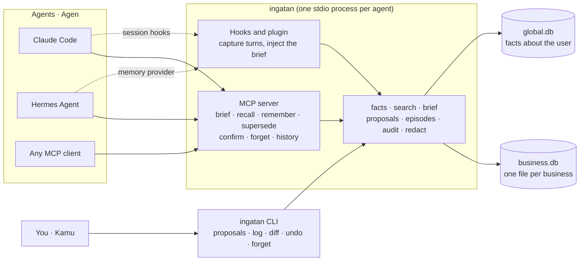

<div align="center">


# Ingatan

**Memory for AI agents that knows when to doubt itself.**<br>
**Memori untuk agen AI yang tahu kapan harus meragukan dirinya sendiri.**

A local MCP server backed by plain SQLite files. No LLM, no embedding model, no API key, no network.<br>
Server MCP lokal di atas berkas SQLite biasa. Tanpa LLM, tanpa model embedding, tanpa API key, tanpa jaringan.

<p>

<a href="https://github.com/araaking/ingatan0-mem/actions/workflows/ci.yml"></a>


</p>

**[Bahasa Indonesia](#bahasa-indonesia)** &nbsp;·&nbsp; **[English](#english)**

</div>

> [!WARNING]
> **Pre-release.** Ingatan is not on PyPI yet and has not been used in a real agent session. Read [Status](#en-status) before you rely on it.<br>
> **Pra-rilis.** Ingatan belum ada di PyPI dan belum pernah dipakai di sesi agen sungguhan. Baca [Status](#id-status) sebelum mengandalkannya.

## Architecture · Arsitektur



The business and the agent name are fixed when the server starts, so no tool call can reach another business. Agents write private notes directly; anything shared waits for your approval in the CLI.

Nama bisnis dan nama agen dikunci saat server menyala, jadi tidak ada pemanggilan tool yang bisa menjangkau bisnis lain. Agen menulis catatan pribadinya langsung; apa pun yang dibagikan menunggu persetujuanmu di CLI.

---

<a id="bahasa-indonesia"></a>

## Bahasa Indonesia

**Daftar isi:** [Ringkasan](#id-ringkasan) · [Fitur utama](#id-fitur) · [Persyaratan](#id-persyaratan) · [Instalasi](#id-instalasi) · [Mulai cepat](#id-mulai-cepat) · [Mode HTTP](#id-http) · [Konfigurasi](#id-konfigurasi) · [Tujuh tool](#id-tool) · [Tier dan antrean proposal](#id-tier) · [Status fakta](#id-status-fakta) · [Forget dan batasannya](#id-forget) · [CLI](#id-cli) · [Data dan privasi](#id-data) · [Angka terukur](#id-angka) · [Status](#id-status) · [Struktur proyek](#id-struktur) · [Pengembangan](#id-pengembangan) · [Peta jalan](#id-peta-jalan) · [Masalah umum](#id-masalah) · [Lisensi dan kredit](#id-lisensi)

<a id="id-ringkasan"></a>

### Ringkasan

Ingatan adalah memori bersama untuk agen AI. Ia berjalan sebagai server MCP lewat stdio dan menyimpan semuanya di berkas SQLite di mesinmu sendiri: satu berkas per bisnis, ditambah satu berkas untuk fakta tentang kamu.

Ingatan dibuat untuk orang yang memakai beberapa agen (asisten umum, agen SEO, agen penulis, agen coding) di beberapa bisnis, dan lelah menjelaskan konteks yang sama berulang kali.

<a id="id-fitur"></a>

### Fitur utama

| | Yang dilakukan Ingatan |
|---|---|
| **Fakta punya tanggal tinjau** | Fakta `volatile` punya tanggal tinjau (bawaan 30 hari, bisa diatur per fakta). Setelah lewat, fakta itu tampil di bagian "check first", bukan sebagai kebenaran. |
| **Tanpa LLM di server** | Pencarian memakai SQLite FTS5 (BM25 dan indeks trigram), kecocokan entitas, dan kebaruan, digabung dengan reciprocal rank fusion. Agen sendiri yang memberi keywords dan entitas saat menyimpan. |
| **Paham imbuhan Indonesia** | Pelepas imbuhan ringan memperluas query, sehingga "dikirim" menemukan fakta yang tertulis "pengiriman". |
| **Scope dikunci server** | Bisnis dan agen ditentukan dari berkas konfigurasi atau variabel lingkungan saat server menyala. Tidak ada tool yang menerima nama bisnis, dan tidak ada pencarian lintas bisnis. |
| **Berbagi harus disetujui** | Tulisan ke tier `business` dan `global` menjadi proposal sampai kamu menyetujuinya di terminal. |
| **Bisa diaudit dan dibatalkan** | Setiap perubahan masuk log append-only. Kamu bisa membaca, membandingkan, dan membatalkannya. |
| **Lupa berarti benar-benar hilang** | `forget` menghapus isi fakta sampai ke byte di berkas database dan berkas WAL. |
| **Rahasia disamarkan** | Teks yang mirip API key, kata sandi, atau token diganti `[redacted]` sebelum disimpan. |

Perbandingan dengan mem0, Hindsight, Graphiti, dan claude-mem ada di [docs/DESIGN.md](docs/DESIGN.md). Perbandingan itu dibuat dengan membaca kode sumber mereka; tidak ada yang dijalankan.

<a id="id-persyaratan"></a>

### Persyaratan

- Python 3.10 atau lebih baru.
- SQLite 3.42 atau lebih baru dengan FTS5, tokenizer trigram, dan FTS5 secure-delete. `ingatan doctor` memeriksa semuanya.
- [uv](https://docs.astral.sh/uv/) untuk instalasi dan pengembangan.
- Tidak perlu Docker, Postgres, atau layanan lain.

<a id="id-instalasi"></a>

### Instalasi

Ingatan belum dirilis ke PyPI, jadi pasang dari hasil clone:

```bash
uv tool install /path/to/ingatan
```

Setelah rilis PyPI nanti, cukup satu perintah (saat ini **belum berfungsi**):

```bash
uvx ingatan
```

<a id="id-mulai-cepat"></a>

### Mulai cepat

```bash
cd proyek-kamu
ingatan init --business tokoku --agent claude-code   # menulis .ingatan.toml dan membuat database
ingatan doctor                                       # memeriksa Python, fitur SQLite, konfigurasi, database
```

`init` aman dijalankan dua kali. Lalu sambungkan ke agen:

| Agen | Panduan | Isi |
|---|---|---|
| Claude Code | [docs/setup-claude-code.md](docs/setup-claude-code.md) | Server MCP, plus hook opsional untuk menyuntikkan brief dan menangkap percakapan |
| Hermes Agent | [docs/setup-hermes.md](docs/setup-hermes.md) | Server MCP, plus plugin memory provider |

Untuk Claude Code, bentuk singkatnya:

```bash
claude mcp add --scope project ingatan -- ingatan serve
```

Kedua panduan menandai mana yang sudah dan belum diverifikasi.

Begitu tersambung, agen memakai tool seperti ini:

```python
remember(
    text="Harga kopi susu naik jadi Rp 18.000 mulai Senin.",
    keywords=["harga", "naik", "kopi", "menu"],  # sinonim dan kata dasar
    entities=["kopi susu"],
)
recall(query="harga kopi susu")
```

<a id="id-http"></a>

### Mode HTTP (opsional)

Satu server Ingatan di mesin yang kamu kuasai (VPS atau server rumah) bisa melayani memori yang sama ke semua perangkat. Klien cukup memakai URL dan token; paket `ingatan` tidak perlu terpasang di sana.

```bash
ingatan token add --business kopi --agent claude-mac    # token tampil sekali
ingatan serve --http                                    # 127.0.0.1:8765, jalur /mcp
```

Setiap token terikat ke satu bisnis dan satu agen. Tidak ada enkripsi di dalam Ingatan: pasang reverse proxy atau jaringan privat (Tailscale, WireGuard) di depannya. Hook dan plugin Hermes belum bisa lewat HTTP. Panduan lengkap: [docs/setup-http.md](docs/setup-http.md).

<a id="id-konfigurasi"></a>

### Konfigurasi

`.ingatan.toml` dicari di folder saat ini atau folder induk terdekat:

```toml
business = "tokoku"
agent = "claude-code"

[brief]
token_budget = 1000
```

| Variabel lingkungan | Fungsi |
|---|---|
| `INGATAN_BUSINESS` | Menimpa `business` dari berkas konfigurasi |
| `INGATAN_AGENT` | Menimpa `agent` dari berkas konfigurasi |
| `INGATAN_HOME` | Folder data. Bawaan: `~/.ingatan/` |

<a id="id-tool"></a>

### Tujuh tool

| Tool | Fungsi |
|---|---|
| `brief()` | Ringkasan awal sesi dalam anggaran token (bawaan 1.000): fakta "check first", lalu fakta global, bisnis, dan agen, jumlah proposal yang menunggu, dan paling banyak tiga episode untuk dicerna. |
| `recall(query)` | Fakta valid yang cocok, masing-masing dengan id, sumber, tanggal, dan status. Fakta yang sudah ditutup hanya muncul dengan `include_closed`. |
| `remember(text, keywords, ...)` | Menyimpan fakta. `keywords` wajib (sinonim, kata dasar). Mengembalikan fakta serupa yang sudah ada. |
| `supersede(old, new)` | Menutup fakta lama dan menautkannya ke yang baru. Untuk fakta bisnis atau global, ini menjadi proposal. |
| `confirm(id, reason)` | Menyatakan fakta yang diragukan masih benar dan memajukan tanggal tinjaunya. Alasan wajib dan dicatat. |
| `forget(id)` | Menghapus isi fakta untuk selamanya. Hanya untuk fakta tier agen. |
| `history(id atau entitas)` | Riwayat perubahan sebuah fakta, proposal, atau entitas. |

<a id="id-tier"></a>

### Tier dan antrean proposal

| Tier | Arti | Cara tertulis |
|---|---|---|
| `agent` | Pribadi untuk satu agen di satu bisnis | Langsung tersimpan |
| `business` | Dibagi ke semua agen di satu bisnis | Menjadi proposal |
| `global` | Tentang kamu, terlihat di semua bisnis | Menjadi proposal |

Agen tidak bisa menulis langsung ke `business` atau `global`, dan tidak punya tool untuk melihat atau menyetujui proposal. `brief` hanya menampilkan jumlah yang menunggu.

```bash
ingatan proposals list
ingatan proposals approve p_0123456789ab
ingatan proposals reject p_0123456789ab
```

<a id="id-status-fakta"></a>

### Status fakta

- **check first**: fakta `volatile` yang sudah lewat tanggal tinjaunya, atau ada proposal yang menunggu untuk menggantikannya. Brief menaruhnya di bagian tersendiri dan meminta agen tidak bertindak sebelum memeriksa. `confirm` atau `supersede` menghapus tanda ini.
- **possible conflict**: saat `remember` menemukan fakta serupa, pasangan itu dicatat sebagai konflik terbuka. Kedua fakta membawa tanda ini sampai agen menyelesaikannya dengan `supersede`, atau dengan `confirm` yang menyebut id fakta satunya di alasan. Pencocokannya leksikal, jadi bisa melewatkan konflik nyata dan bisa menandai dua fakta yang sebenarnya sejalan.

`ingatan conflicts` melaporkan dari log audit berapa kandidat konflik yang diselesaikan.

<a id="id-forget"></a>

### Forget dan batasannya

`forget` menghapus baris fakta, entri indeks pencarian, pasangan konfliknya, salinan di proposal, episode asalnya, dan isi semua entri log sebelumnya tentang fakta itu. Satu entri log tanpa isi tetap ada, supaya jejak audit menunjukkan bahwa sebuah forget pernah terjadi.

<details>
<summary><strong>Batasan yang perlu kamu tahu</strong></summary>

- **Cadangan dan salinan lama tidak tersentuh.** Backup, folder sinkronisasi, atau snapshot disk yang dibuat sebelum forget masih memuat fakta itu.
- **Catatan WAL.** Pembersihan butuh database bebas sesaat. Kalau proses Ingatan lain sedang menyibukkannya, `forget` tetap menghapus fakta tetapi melaporkan bahwa byte lama mungkin masih ada di WAL sampai proses itu selesai.
- Tidak ada janji tentang cara perangkat penyimpanan atau sistem berkas menangani blok yang dibebaskan.
- Forget tidak bisa dibatalkan. Fakta yang ditutup demi fakta yang dilupakan tetap tertutup.
- Agen hanya bisa melupakan fakta tier agen miliknya sendiri. Fakta bisnis atau global butuh kamu: `ingatan forget <fact_id>`.

</details>

<a id="id-cli"></a>

### CLI

Perintah bertindak sebagai kamu untuk bisnis dan agen yang dikonfigurasi. Entri pribadi agen lain tetap tersembunyi; perintah yang membaca log menerima `--agent NAMA` untuk membuka konteks sebagai agen itu.

| Perintah | Fungsi |
|---|---|
| `ingatan` / `ingatan serve` | Menjalankan server MCP lewat stdio |
| `ingatan serve --http [--host H] [--port P]` | Menjalankan server MCP lewat HTTP (bearer token) |
| `ingatan token add --business B --agent A [--label L]`, `list`, `revoke <id>` | Mengelola token mode HTTP |
| `ingatan init [--business NAMA] [--agent NAMA]` | Membuat `.ingatan.toml` dan database |
| `ingatan doctor` | Memeriksa Python, fitur SQLite, konfigurasi, database, dan folder data |
| `ingatan log [--limit N] [--fact ID] [--agent NAMA]` | Daftar entri log, terbaru dulu |
| `ingatan diff <log_id>` | Sebelum dan sesudah satu entri log |
| `ingatan undo <log_id>` | Membatalkan create, supersede, confirm, atau approve (bukan forget) |
| `ingatan proposals list`, `approve <id>`, `reject <id>` | Meninjau proposal |
| `ingatan forget <fact_id> [--yes]` | Melupakan fakta dari tier mana pun |
| `ingatan ingest <path>` | Membaca berkas Markdown menjadi catatan yang bisa dicari, terpisah dari fakta |
| `ingatan conflicts` | Laporan penyelesaian konflik dari log |
| `ingatan hook <event>` | Titik masuk hook Claude Code; selalu keluar dengan kode 0 |

<a id="id-data"></a>

### Data dan privasi

- Folder data adalah `$INGATAN_HOME` bila diatur, selain itu `~/.ingatan/`. Tidak ada yang disimpan di folder proyek, jadi memori tidak bisa ikut ter-commit ke git.
- `<business>.db` menyimpan fakta bisnis dan agen, episode, catatan, dan konflik. `global.db` menyimpan fakta global. Keduanya berkas SQLite biasa.
- `capture-errors.log` di folder data mendapat satu baris saat hook atau plugin gagal. Hook tidak pernah menghentikan sesi agen.
- Penyamaran rahasia memakai pencocokan pola dan bisa meleset.
- Server tidak melakukan panggilan jaringan.

<a id="id-angka"></a>

### Angka terukur

Sumber: [evals/reports/latest.md](evals/reports/latest.md) (dijalankan 2026-11-11, tanpa LLM, tanpa jaringan) dan [docs/RAM.md](docs/RAM.md).

Eval berisi 40 skenario berbahasa Indonesia, semuanya berbasis pola dan ditulis oleh pembuatnya. Belum ada insiden nyata di dalamnya. Jadi angka ini adalah **baseline regresi**, bukan bukti akurasi di pemakaian nyata, dan targetnya masih tebakan awal.

| Metrik | Hasil | Target tebakan awal |
|---|---|---|
| Skenario | 40 dijalankan, 40 lulus | tidak ada |
| recall@5 | 100,0% dari 45 pemeriksaan | di atas 80% |
| Stale rate | 0,0% dari 63 pemeriksaan recall | di bawah 5% |
| Leak rate | 0,0% (0 dari 86 hasil) | 0 |
| Token per brief | rata-rata 65, maksimum 278 dari 19 brief | sekitar 1.000 |

Pemakaian memori satu proses server stdio: 70,2 MB saat diam dan 73,6 MB setelah 500 fakta disimpan. Diukur sekali, di satu laptop Windows 11, Python 3.11.16, mcp 2.3.0.

<a id="id-status"></a>

### Status

Yang **belum** diverifikasi:

- Belum pernah berjalan di sesi Claude Code sungguhan. Hook dan pengaturan MCP ditulis dari dokumentasi Claude Code dan diuji dengan masukan simulasi.
- Plugin Hermes belum pernah dimuat oleh Hermes sungguhan. Plugin ditulis dari dokumentasi upstream dan plugin pihak ketiga.
- Belum ada di PyPI. Workflow rilis baru berfungsi setelah trusted publisher PyPI dikonfigurasi.
- CI (test, lint, type check, eval, dan instalasi wheel di Windows, macOS, Linux) sudah ditulis tetapi belum pernah berjalan di GitHub.
- Set eval belum memuat insiden nyata. Sekitar sepuluh masih dibutuhkan; lihat [evals/scenarios/incidents/README.md](evals/scenarios/incidents/README.md).
- Porsi kandidat konflik yang benar-benar diselesaikan agen belum diukur dari pemakaian nyata.
- RAM di VPS Linux, dan di sistem selain laptop Windows di atas.
- Konkurensi diuji dengan beberapa proses lokal, belum di network drive atau folder sinkronisasi.

<a id="id-struktur"></a>

### Struktur proyek

```text
src/ingatan/
  db/            koneksi, WAL, migrasi bernomor
  redact/        penyamaran rahasia
  scope/         konfigurasi, tier, visibilitas
  tokens/        token bearer untuk mode HTTP
  audit/         log append-only, diff, undo
  search/        BM25, trigram, entitas, kebaruan, pelepas imbuhan
  facts/         remember, supersede, confirm, forget, history
  proposals/     antrean proposal
  episodes/      tangkapan percakapan dan tawaran digest
  brief/         penyusun brief
  ingest/        ingest Markdown
  mcp/           server MCP (stdio, dan HTTP di http.py)
  cli/           perintah untuk manusia
  integrations/  hook Claude Code dan plugin Hermes
evals/           harness dan 40 skenario
tests/           satu folder per modul
docs/            desain, PRD, rencana, kontrak, panduan setup
```

<a id="id-pengembangan"></a>

### Pengembangan

```bash
uv sync
uv run python -m pytest -q
uv run ruff check .
uv run ruff format --check .
uv run python -m pyright
uv run python -m evals
```

Peta modul, aturan lapisan, cara menambah skenario eval, dan cara menambah migrasi ada di [CONTRIBUTING.md](CONTRIBUTING.md). Dokumen lain: [DESIGN](docs/DESIGN.md) (alasan), [PRD](docs/PRD.md) (persyaratan), [PLAN](docs/PLAN.md) (tugas), [ARCHITECTURE](docs/ARCHITECTURE.md) (kontrak), [HOOK_FINDINGS](docs/HOOK_FINDINGS.md), [evals/README](evals/README.md).

<a id="id-peta-jalan"></a>

### Peta jalan

Setelah MVP, menurut [docs/DESIGN.md](docs/DESIGN.md): pencarian vektor opsional (`ingatan[vector]`), digest episode oleh LLM di sisi server (`ingatan[llm]`), mode HTTP untuk berbagi antar mesin (versi pertama sudah ada, lihat [docs/setup-http.md](docs/setup-http.md)), integrasi code graph, dan UI. Semuanya opsional; setiap fitur harus tetap berjalan tanpa API key.

<a id="id-masalah"></a>

### Masalah umum

| Gejala | Yang dicoba |
|---|---|
| `ingatan doctor` gagal di FTS5, trigram, atau secure-delete | Pakai build Python dengan SQLite 3.42 atau lebih baru. |
| Server berhenti dengan pesan konfigurasi | Jalankan `ingatan init`, atau atur `INGATAN_BUSINESS` dan `INGATAN_AGENT`. |
| Hook tidak menangkap apa pun | Lihat `capture-errors.log` di folder data. Hook sengaja diam saat gagal. |
| `forget` melaporkan WAL masih sibuk | Tutup proses Ingatan lain, lalu jalankan forget lagi atau mulai ulang. |
| `uvx ingatan` tidak ditemukan | Paket belum ada di PyPI. Pasang dari clone. |

<a id="id-lisensi"></a>

### Lisensi dan kredit

Apache-2.0, lihat [LICENSE](LICENSE).

Pemetaan tangkap dan suntik ke hook tiap agen (hook Claude Code, antarmuka memory provider Hermes) disusun dengan claude-mem sebagai referensi, terutama plugin Hermes-nya. Terima kasih kepada para pembuatnya.

<div align="right"><a href="#ingatan">Kembali ke atas</a></div>

---

<a id="english"></a>

## English

**Contents:** [Overview](#en-overview) · [Key features](#en-features) · [Requirements](#en-requirements) · [Installation](#en-installation) · [Quick start](#en-quick-start) · [HTTP mode](#en-http) · [Configuration](#en-configuration) · [The seven tools](#en-tools) · [Tiers and the proposal queue](#en-tiers) · [Fact status](#en-fact-status) · [Forget and its limits](#en-forget) · [CLI](#en-cli) · [Data and privacy](#en-data) · [Measured numbers](#en-numbers) · [Status](#en-status) · [Project structure](#en-structure) · [Development](#en-development) · [Roadmap](#en-roadmap) · [Troubleshooting](#en-troubleshooting) · [License and credits](#en-license)

<a id="en-overview"></a>

### Overview

Ingatan ("memory" in Indonesian) is a shared memory for AI agents. It runs as an MCP server over stdio and keeps everything in SQLite files on your own machine: one file per business, plus one file for facts about you.

It is built for people who use several agents (a general assistant, an SEO agent, a writer, coding agents) across several businesses, and are tired of explaining the same context again.

<a id="en-features"></a>

### Key features

| | What Ingatan does |
|---|---|
| **Facts carry a review date** | A `volatile` fact has a review date (30 days by default, settable per fact). Once it passes, the fact is shown under "check first" instead of as truth. |
| **No LLM on the server** | Search uses SQLite FTS5 (BM25 and a trigram index), entity match and recency, fused by reciprocal rank. The agent supplies keywords and entities when it saves a fact. |
| **Understands Indonesian affixes** | A small affix stripper widens the query, so "dikirim" finds a fact that says "pengiriman". |
| **Scope fixed by the server** | The business and the agent come from a config file or environment variables at start-up. No tool takes a business name, and there is no cross-business search. |
| **Sharing needs approval** | Writes to the `business` and `global` tiers stay proposals until you approve them in the terminal. |
| **Auditable and reversible** | Every change goes to an append-only log. You can read it, diff it and undo it. |
| **Forget means gone** | `forget` removes a fact's content down to the bytes in the database file and its WAL file. |
| **Secrets are redacted** | Text that looks like an API key, password or token is replaced with `[redacted]` before it is stored. |

The comparison with mem0, Hindsight, Graphiti and claude-mem is in [docs/DESIGN.md](docs/DESIGN.md). It was made by reading their source; nothing was run.

<a id="en-requirements"></a>

### Requirements

- Python 3.10 or newer.
- SQLite 3.42 or newer with FTS5, the trigram tokenizer and FTS5 secure-delete. `ingatan doctor` checks all of it.
- [uv](https://docs.astral.sh/uv/) for installing and developing.
- No Docker, Postgres or other service.

<a id="en-installation"></a>

### Installation

Ingatan is not on PyPI yet, so install from a checkout:

```bash
uv tool install /path/to/ingatan
```

After the PyPI release it will be one command (this **does not work yet**):

```bash
uvx ingatan
```

<a id="en-quick-start"></a>

### Quick start

```bash
cd your-project
ingatan init --business tokoku --agent claude-code   # writes .ingatan.toml and creates the databases
ingatan doctor                                       # checks Python, SQLite features, config, databases
```

`init` is safe to run twice. Then connect an agent:

| Agent | Guide | Covers |
|---|---|---|
| Claude Code | [docs/setup-claude-code.md](docs/setup-claude-code.md) | The MCP server, plus optional hooks that inject the brief and capture turns |
| Hermes Agent | [docs/setup-hermes.md](docs/setup-hermes.md) | The MCP server, plus a memory-provider plugin |

For Claude Code the short form is:

```bash
claude mcp add --scope project ingatan -- ingatan serve
```

Both guides mark what has and has not been verified.

Once connected, an agent uses the tools like this:

```python
remember(
    text="Harga kopi susu naik jadi Rp 18.000 mulai Senin.",
    keywords=["harga", "naik", "kopi", "menu"],  # synonyms and root words
    entities=["kopi susu"],
)
recall(query="harga kopi susu")
```

<a id="en-http"></a>

### HTTP mode (optional)

One Ingatan server on a machine you control (a VPS or a home server) can serve the same memory to every device. A client needs only a URL and a token; the `ingatan` package does not have to be installed there.

```bash
ingatan token add --business kopi --agent claude-mac    # the token is shown once
ingatan serve --http                                    # 127.0.0.1:8765, path /mcp
```

Each token is tied to one business and one agent. Ingatan does not encrypt traffic itself: put a reverse proxy or a private network (Tailscale, WireGuard) in front. The hooks and the Hermes plugin do not work over HTTP yet. Full guide: [docs/setup-http.md](docs/setup-http.md).

<a id="en-configuration"></a>

### Configuration

`.ingatan.toml` is found in the current folder or the nearest parent:

```toml
business = "tokoku"
agent = "claude-code"

[brief]
token_budget = 1000
```

| Environment variable | Purpose |
|---|---|
| `INGATAN_BUSINESS` | Overrides `business` from the config file |
| `INGATAN_AGENT` | Overrides `agent` from the config file |
| `INGATAN_HOME` | Data folder. Default: `~/.ingatan/` |

<a id="en-tools"></a>

### The seven tools

| Tool | What it does |
|---|---|
| `brief()` | Session-start summary within a token budget (default 1,000): "check first" facts, then global, business and agent facts, the number of proposals waiting, and up to three captured episodes to digest. |
| `recall(query)` | Valid facts matching the query, each with id, source, date and status. Closed facts appear only with `include_closed`. |
| `remember(text, keywords, ...)` | Saves a fact. `keywords` are required (synonyms, root words). Returns similar existing facts. |
| `supersede(old, new)` | Closes the old fact and links it to the new one. For a business or global fact it becomes a proposal. |
| `confirm(id, reason)` | Says a doubtful fact is still true and moves its review date forward. A reason is required and logged. |
| `forget(id)` | Deletes a fact's content for good. Agent-tier facts only. |
| `history(id or entity)` | The change history of a fact, a proposal or an entity. |

<a id="en-tiers"></a>

### Tiers and the proposal queue

| Tier | Meaning | How it is written |
|---|---|---|
| `agent` | Private to one agent in one business | Saved at once |
| `business` | Shared by every agent of one business | Becomes a proposal |
| `global` | About you, visible in every business | Becomes a proposal |

An agent cannot write to `business` or `global` directly, and has no tool to list or approve proposals. `brief` only shows how many are waiting.

```bash
ingatan proposals list
ingatan proposals approve p_0123456789ab
ingatan proposals reject p_0123456789ab
```

<a id="en-fact-status"></a>

### Fact status

- **check first**: a `volatile` fact past its review date, or one that a proposal is waiting to replace. The brief lists these in their own section and tells the agent not to act on them before checking. `confirm` or `supersede` clears the mark.
- **possible conflict**: when `remember` finds a similar fact, the pair is recorded as an open conflict. Both facts carry this tag until the agent resolves it with `supersede`, or with `confirm` naming the other fact id in the reason. The matching is lexical, so it can miss a real conflict and can flag two facts that agree.

`ingatan conflicts` reports, from the audit log, how many conflict candidates were resolved.

<a id="en-forget"></a>

### Forget and its limits

`forget` removes the fact row, its search-index entries, its conflict pairs, the copies in proposals, the episode it was digested from, and the content of every earlier log entry about it. One log entry without content remains, so the audit trail shows that a forget happened.

<details>
<summary><strong>Limits you should know</strong></summary>

- **Earlier backups and copies are not touched.** A backup, sync folder or disk snapshot made before the forget still contains the fact.
- **The WAL note.** The purge needs the database to be free for a moment. If another Ingatan process keeps it busy, `forget` still deletes the fact but reports that old bytes may remain in the WAL until that process finishes.
- Nothing is promised about how the storage hardware or file system handles freed blocks.
- A forget cannot be undone. Facts that were closed in favour of the forgotten one stay closed.
- An agent can forget only its own agent-tier facts. A business or global fact needs you: `ingatan forget <fact_id>`.

</details>

<a id="en-cli"></a>

### CLI

Commands act as you for the configured business and agent. Another agent's private entries stay hidden; commands that read the log take `--agent NAME` to open the context as that agent.

| Command | Purpose |
|---|---|
| `ingatan` / `ingatan serve` | Start the MCP server on stdio |
| `ingatan serve --http [--host H] [--port P]` | Start the MCP server over HTTP (bearer tokens) |
| `ingatan token add --business B --agent A [--label L]`, `list`, `revoke <id>` | Manage the HTTP-mode tokens |
| `ingatan init [--business NAME] [--agent NAME]` | Create `.ingatan.toml` and the databases |
| `ingatan doctor` | Check Python, SQLite features, config, databases and the data folder |
| `ingatan log [--limit N] [--fact ID] [--agent NAME]` | List log entries, newest first |
| `ingatan diff <log_id>` | Before and after of one log entry |
| `ingatan undo <log_id>` | Reverse a create, supersede, confirm or approve (not a forget) |
| `ingatan proposals list`, `approve <id>`, `reject <id>` | Review proposals |
| `ingatan forget <fact_id> [--yes]` | Forget a fact of any tier |
| `ingatan ingest <path>` | Read Markdown files into searchable notes, kept apart from facts |
| `ingatan conflicts` | Conflict-resolution report from the log |
| `ingatan hook <event>` | Claude Code hook entry point; always exits 0 |

<a id="en-data"></a>

### Data and privacy

- The data folder is `$INGATAN_HOME` if set, otherwise `~/.ingatan/`. Nothing is stored in the project folder, so memory cannot be committed to git by accident.
- `<business>.db` holds business and agent facts, episodes, notes and conflicts. `global.db` holds global facts. Both are plain SQLite files.
- `capture-errors.log` in the data folder gets one line when a hook or plugin fails. Hooks never stop the agent session.
- Redaction is pattern matching and can miss secrets.
- The server makes no network call.

<a id="en-numbers"></a>

### Measured numbers

Sources: [evals/reports/latest.md](evals/reports/latest.md) (run on 2026-11-11, no LLM, no network) and [docs/RAM.md](docs/RAM.md).

The eval is 40 scenarios in Indonesian, all pattern-based and written by the implementers. It contains no real incidents yet. These numbers are therefore a **regression baseline**, not evidence of accuracy in real use, and the targets are first guesses.

| Metric | Result | First-guess target |
|---|---|---|
| Scenarios | 40 run, 40 pass | none |
| recall@5 | 100.0% over 45 checks | over 80% |
| Stale rate | 0.0% over 63 recall checks | under 5% |
| Leak rate | 0.0% (0 of 86 results) | 0 |
| Tokens per brief | mean 65, max 278 over 19 briefs | about 1,000 |

Memory use of one stdio server process: 70.2 MB idle and 73.6 MB after 500 facts were saved. Measured once, on one Windows 11 laptop, Python 3.11.16, mcp 2.3.0.

<a id="en-status"></a>

### Status

What is **not** verified yet:

- No run inside a real Claude Code session. The hooks and the MCP setup are written from the Claude Code documentation and tested with simulated input.
- The Hermes plugin has never been loaded by a real Hermes. It is written from upstream docs and third-party plugins.
- Not on PyPI. The release workflow only works after a PyPI trusted publisher is configured.
- CI (tests, lint, type check, evals, and a wheel install on Windows, macOS and Linux) is written but has not run on GitHub yet.
- The eval set has no real incidents. About ten are still wanted; see [evals/scenarios/incidents/README.md](evals/scenarios/incidents/README.md).
- The share of conflict candidates that agents actually resolve has not been measured from real use.
- RAM on a Linux VPS, and on any system other than the Windows laptop above.
- Concurrency is tested with several local processes, not on network drives or synced folders.

<a id="en-structure"></a>

### Project structure

```text
src/ingatan/
  db/            connections, WAL, numbered migrations
  redact/        secret redaction
  scope/         config, tiers, visibility
  tokens/        bearer tokens for HTTP mode
  audit/         append-only log, diff, undo
  search/        BM25, trigram, entity, recency, affix stripper
  facts/         remember, supersede, confirm, forget, history
  proposals/     proposal queue
  episodes/      captured turns and the digest offer
  brief/         brief builder
  ingest/        Markdown ingest
  mcp/           MCP server (stdio, and HTTP in http.py)
  cli/           commands for humans
  integrations/  Claude Code hooks and the Hermes plugin
evals/           harness and 40 scenarios
tests/           one folder per module
docs/            design, PRD, plan, contract, setup guides
```

<a id="en-development"></a>

### Development

```bash
uv sync
uv run python -m pytest -q
uv run ruff check .
uv run ruff format --check .
uv run python -m pyright
uv run python -m evals
```

The module map, the layering rule, how to add an eval scenario and how to add a migration are in [CONTRIBUTING.md](CONTRIBUTING.md). Other documents: [DESIGN](docs/DESIGN.md) (why), [PRD](docs/PRD.md) (requirements), [PLAN](docs/PLAN.md) (tasks), [ARCHITECTURE](docs/ARCHITECTURE.md) (contract), [HOOK_FINDINGS](docs/HOOK_FINDINGS.md), [evals/README](evals/README.md).

<a id="en-roadmap"></a>

### Roadmap

After the MVP, per [docs/DESIGN.md](docs/DESIGN.md): optional vector search (`ingatan[vector]`), server-side LLM digest of episodes (`ingatan[llm]`), an HTTP mode for sharing across machines (a first version exists, see [docs/setup-http.md](docs/setup-http.md)), code-graph integration, and a UI. All optional; every feature must keep working with no API key.

<a id="en-troubleshooting"></a>

### Troubleshooting

| Symptom | What to try |
|---|---|
| `ingatan doctor` fails on FTS5, trigram or secure-delete | Use a Python build with SQLite 3.42 or newer. |
| The server exits with a config message | Run `ingatan init`, or set `INGATAN_BUSINESS` and `INGATAN_AGENT`. |
| Hooks capture nothing | Look at `capture-errors.log` in the data folder. Hooks stay silent on failure by design. |
| `forget` reports the WAL is still busy | Close other Ingatan processes, then forget again or restart. |
| `uvx ingatan` is not found | The package is not on PyPI yet. Install from a checkout. |

<a id="en-license"></a>

### License and credits

Apache-2.0, see [LICENSE](LICENSE).

The mapping of capture and injection onto each agent's hooks (Claude Code hooks, the Hermes memory-provider interface) was worked out with claude-mem as a reference, in particular its Hermes plugin. Thank you to its authors.

<div align="right"><a href="#ingatan">Back to top</a></div>
